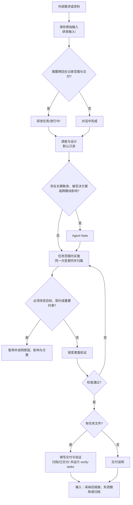
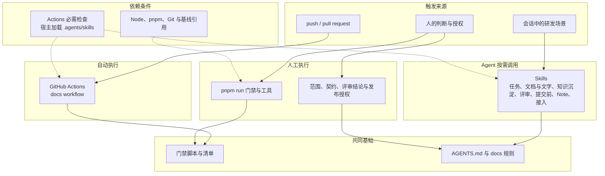

# agent-dev-template

面向 AI Agent 辅助软件研发的项目模板。它把研发输入、研发任务、设计决策、系统认知和工程知识放进各自唯一的归属位置，并让文档维护成为研发流程的一部分，而不是研发结束后的整理工作。

本仓库既是模板源仓库，也是这套体系的第一次实践：`docs/` 记录体系自身，研发活动本身用来验证和修正这套体系。

## 解决什么问题

- **认知分层**：架构、子系统、模块文档分别回答“由什么组成”“能力契约是什么”“这个单元怎么用”，读者按需深入。
- **决策留存**：Agent Notes 记录问题、方案、取舍和后果，被否决的方案一并保留，避免反复争论。
- **文档跟随研发**：触发表、专项 Skills 和变更影响检查共同推动一次改动同步它所属的文档。
- **知识参与研发**：缺陷模式、开发准则、操作指南和 Skills 在对应场景被加载，而不是堆在知识库里。
- **机械约束优先**：能由脚本判定的结构、格式、链接、预算和冻结规则不依赖 Agent 自觉。

## 组成

| 部分 | 目录 | 负责 |
|---|---|---|
| 研发输入 | [研发输入/](研发输入/README.md) | 原始需求、外部约束、参考资料、梳理草稿 |
| 研发任务 | [研发任务/](研发任务/README.md) | 当前任务目标、范围、进展、交付与归档 |
| 研发演进 | [.agents/notes/](.agents/notes/README.md) | 问题、方案、决策、取舍、否决与归档 |
| 系统认知 | [架构](docs/architecture.md)、[子系统](docs/subsystems/README.md)、模块 README、[持久化记录](docs/persistence-changes/README.md) | 当前系统是什么样 |
| 工程知识 | [核心准则](docs/core-guidelines/README.md)、[防御性模式](docs/defensive-patterns/README.md)、[cookbook](docs/cookbook/README.md)、[复盘](docs/postmortem/README.md)、`.agents/skills/` | 怎样正确地设计和操作 |
| 治理 | 根 [AGENTS.md](AGENTS.md)、[文档标准](docs/AGENTS.md)、[scripts](scripts/README.md)、`.github/workflows/` | 何时做、做没做、格式是否正确 |

对参考体系（DSH）的研究结论见 [对 DSH 开发体系研究](docs/对dsh开发体系研究/README.md)；它记录可复用的设计原则和不采纳的理由，不是本仓库的规则。

## 研发场景与工作路径

本仓库没有统一的研发流水线。开始工作前先判断属于哪个场景，再决定从哪里开始、调用哪些机制、留下什么，以及做到什么程度算结束。场景可以组合（外部需求驱动中常包含复杂问题的调查分支），也可以跳过（简单修改不建任务、不写 Note），一次工作不要求经历全部场景。

机制的约束力不同：任务、Agent Note 和文档的结构由 `scripts/` 门禁机械检查，违反即失败；同一变更内的文档与记录义务、交付说明和范围授权是软约束，靠评审追回，没有门禁能判定。Skills 是否加载、CI 是否运行等执行方式与宿主依赖见下文 [研发活动与触发机制](#研发活动与触发机制)，尚未实现的能力见 [尚未实现与需要自行配置](#尚未实现与需要自行配置)。

### 判断当前场景

| 你现在的情况 | 场景 | 从哪里开始 | 通常产生什么 |
|---|---|---|---|
| 咨询、解释机制、调研现状、讨论方案 | 简单问题（只读） | 直接调查或回答，默认只读 | 对话结论；必要时链接现有文档 |
| 局部缺陷、小修改、机械性编辑 | 简单问题（直接实施） | 直接修改，按变更面选最小检查 | 变更本身；不建任务、不写 Note |
| 收到需求、缺陷报告或外部资料，需要实施和交付 | 外部需求驱动研发 | `研发输入/`，再整理为任务 | 输入、任务、Note、docs、交付记录 |
| 从零开始一个新项目 | 新项目初始化 | [project-onboarding](.agents/skills/project-onboarding/SKILL.md) 的空项目路径 | 最小 README、AGENTS、architecture、已存在模块的文档 |
| 已有项目带着旧 AGENTS、开发 README、索引或旧流程 | 旧体系迁移 | [project-onboarding](.agents/skills/project-onboarding/SKILL.md) 的已有项目路径，先备份 | 备份目录、handover、重建的系统认知、人确认的边界 |
| 问题不明确、影响范围大、方案有争议，或触及跨模块契约、持久化结构 | 复杂问题 | 先建立范围与依据，再调查和决策 | 任务、Agent Note、设计证据、评审结论 |
| 已有本地变更或 PR 待评审 | 评审 | [code-review](.agents/skills/code-review/SKILL.md) 与 `change-scope` | blocker 与 suggestion 报告 |
| 准备提交或推送 | 提交前检查 | [pre-push-checks](.agents/skills/pre-push-checks/SKILL.md) | 最小检查结果与交付说明 |
| 修复了隐蔽、系统性、重复发现成本高的缺陷 | 经验沉淀 | [复盘](docs/postmortem/README.md) 与 [防御性模式](docs/defensive-patterns/README.md) | 复盘记录、防御性模式或准则 |
| 操作已验证且会重复执行，或同一写法在评审中反复出现 | 经验沉淀 | [cookbook](docs/cookbook/README.md) 或 [核心准则](docs/core-guidelines/README.md) | 操作步骤或编号准则 |
| 修改 `scripts/` 门禁、`docs/` 层级或 Agent Note 规则 | 治理机制变更 | 根 [AGENTS.md](AGENTS.md) 触发表 | 归属文档同步、失败路径用例、门禁通过 |
| Agent Notes 需要审计、精简或归档 | Note 归档 | [archive-agent-notes](.agents/skills/archive-agent-notes/SKILL.md) | 归档、删除或合并后的 Note 与冻结 manifest |

判断依据是“这次要交付什么”，不是改动文件数量或耗时。已经有变更待评审、准备提交或推送、需要复盘或沉淀经验、修改治理机制、审计 Note 时，直接进入后面对应的专项场景。

### 外部需求驱动研发

**触发**：收到外部需求、缺陷报告、验收标准、外部接口文档、协议或调研资料，需要具体实施和交付。

**工作路径**

1. **保存原始输入**：原始材料放 [研发输入](研发输入/README.md)，按来源或主题分目录，保留原文件名、来源与版本或链接。它回答“依据什么”，不是已确认的决策；没有外部材料的内部目标不必造一份输入，直接在任务里写目标。
2. **整理任务**：通过对话把材料收敛为目标、范围、验收、不做和关联输入。需要跨回合、并记录范围、进展和交付时，按 [task-management](.agents/skills/task-management/SKILL.md) 在 `研发任务/进行中/` 建一份任务文件并链接输入；目标明确、一次能完成的工作可以直接在对话里做，并在交付说明中报告。
3. **调查与设计**：默认只读。读根 [AGENTS.md](AGENTS.md)、[体系架构](docs/architecture.md)、相关 [子系统](docs/subsystems/README.md)、模块文档和已有 Agent Note；以代码、测试、配置和实际行为取证，不按目录名或旧文档推断。长期取舍、被否决方案或跨模块影响写 [Agent Note](.agents/notes/README.md)；当前系统事实写进 `docs/` 或模块 README；无法确认的事项记为缺口。
4. **实施**：在任务范围内自主完成必要修改。用户明确要求的跨模块契约变更直接实施并做影响分析；发现必须改变用户未要求的契约、目标或重要约束时暂停，说明原因、影响和方案。同一次变更按根 AGENTS 触发表同步 Note、docs、模块文档和持久化记录，并完成触发表要求的检查。
5. **验证**：按变更面选择最小检查（见 [pre-push-checks](.agents/skills/pre-push-checks/SKILL.md) 的映射表）。文档与链接用 `test:docs`，Agent Note 用 `test:notes`，门禁脚本用 `test:gates` 加受影响门禁，代码用拥有该行为的聚焦测试。失败停止，不把未执行的检查报告为通过；`verify-change-docs` 按路径列出本次变更的文档归属，当前规则均为提示级，不阻断。
6. **交付**：任务文件写最终交付结果、验证结果和遗留问题，`status` 改为 `已交付`，移到 `研发任务/归档/已交付/` 并运行 `pnpm run verify-tasks`；没有任务文件时，在交付说明中报告实际变更、命令与结果、风险和未覆盖项。交付不等于发布。
7. **收尾与归档**：被采纳的输入用相对链接关联任务或 Note 的 `## Problem` 并说明采纳范围，不在原文件追加结论；失效输入整份删除或移入按需建立的归档子目录。终态任务不回到 `进行中/`，需要继续时新建任务并把旧任务标为 `已替代`。Agent Note 按被取代关系归档、合并或删除。

**必要判断**

- 是否需要任务文件：需要跨回合记录范围、进展、验收或交付时建立；否则直接在对话完成并在交付说明中报告。
- 是否需要 Agent Note：只有长期取舍、被否决方案或跨模块影响需要记录；机械性或局部编辑豁免。
- 是否暂停：越出用户要求的目标、契约或重要约束时暂停确认；范围内的技术选择和必要关联修改自主完成。

**信息载体**

| 载体 | 何时使用 | 结束时 |
|---|---|---|
| [研发输入](研发输入/README.md) | 保存外部原文、来源和约束 | 被采纳后链接；失效删除或归档 |
| [研发任务](研发任务/README.md) | 记录目标、范围、验收、进展和交付 | 终态归档，是唯一的交付记录 |
| [Agent Note](.agents/notes/README.md) | 长期取舍、替代方案、后果和必需验证 | 保持活跃，或被取代、归档、删除 |
| `docs/` 与模块 README | 描述当前系统事实 | 随行为持续同步 |
| 任务文件或交付说明 | 写出实际交付与验证结果 | 随任务归档，不另建交付报告 |

**机制调用**：必须项是建了任务就按 [任务规则](研发任务/README.md) 维护并运行 `verify-tasks`，改了 Note 就满足 [Note 规则](.agents/notes/README.md) 并运行 `test:notes`，改了文档就运行 `test:docs`，同一次变更完成根 AGENTS 触发表要求的同步。按需项是 Skills（`task-management`、`doc-writing`、`prose-standard`、`code-review`、`pre-push-checks`、`archive-agent-notes`）与 `change-scope`。宿主依赖是 Skills 是否加载和 CI 是否运行；门禁覆盖不到的内容由评审判断。

**结束条件**：目标范围完成、按面检查通过、交付与验证记录写实、任务归档、输入和 Note 完成相应处理。未完成项、未验证项和暂缓项必须写明；交付完成不等于发布；仍有效的系统事实留在 `docs/`，仍有指导价值的决策理由留在 Agent Note。

### 新项目初始化

**触发**：空项目或刚起步，还没有研发规则、系统认知和文档体系。

**工作路径**

1. 记录项目目标、用户、外部约束和验收方式；原始材料放 `研发输入/`，不写成已确认决策。
2. 建立最小 `README.md`、根 `AGENTS.md` 和 `docs/architecture.md`；小项目的架构可以只有一页。
3. 只建当前已经存在的模块文档；没有代码的层级不建空目录，也不建 `docs/handover/` 或旧资料备份。
4. 建立最小本地检查入口（如 `test:docs`、`test:notes`），随技术栈再增加代码检查与 CI。
5. 出现长期取舍时按 [Agent Note 规则](.agents/notes/README.md) 建 Note；机械或局部修改不建。

**必要判断**

- 架构、模块和子系统边界由人确认；Agent 只提出带证据的建议，不自行认定。
- Module 是具有独立职责和维护价值的软件单元，不是每个目录都建模块文档；两个模块的简单调用不建子系统；模块组只在多个模块需要一起理解时建立。
- 旧资料不能直接当当前事实；少量旧资料按旧体系迁移的筛选规则处理，不复制整套旧文档。

**信息载体与机制**：入口是 [project-onboarding](.agents/skills/project-onboarding/SKILL.md)；产物是最小的 `README.md`、根 `AGENTS.md`、`docs/architecture.md` 以及已存在模块的文档，边界和暂缓项由人确认。本仓库不提供可直接复制的 `template/` 目录，新项目参考本仓库的目录与规则建立最小结构。没有专用门禁，结构质量靠评审保证。

**结束条件**：最小 README、AGENTS、architecture 可用，已存在模块有文档，检查入口能运行，边界经人确认；不预建尚不存在的层级。

### 旧体系迁移

**触发**：已有项目带着旧 `AGENTS.md`、开发 README、索引或旧流程等治理入口，需要新体系接管。

**工作路径**

1. **备份与隔离**：把旧 `AGENTS.md`、开发 README、索引和旧流程等治理入口移入统一备份目录，默认放在仓库外同级 `<project>-legacy/`，保留原路径；备份根 README 首行写明“旧体系资料，非当前权威，不再维护”。根 `README.md` 默认保留并改写为新入口页；产品 README、API 与安装使用说明、法律文件、原始输入和仍在使用的构建与 CI 配置不属于旧治理文档，不盲目移动。移动前先建立新入口，并保留“旧路径 → 新归属或备份位置”的映射。
2. **筛选旧资料**：可验证的当前事实按代码重建到 `docs/`，归属未定的先放 handover；真实需求与外部约束留在 `研发输入/`；仍有长期价值的设计理由进 Agent Note；历史记录、AI 中间过程和重复总结不迁移，由人决定保留或清理；无法确认的事实记为未知或缺口，不写成当前事实。
3. **建立代码事实**：调查入口与运行方式、构建与测试、配置与外部依赖、数据与兼容、主要单元；每条建议记录文件、测试或配置证据，不从目录名推断模块边界。
4. **建立交接暂存区**：`docs/handover/` 平铺，不建子目录；README 说明它是接入期临时参考、不是当前权威；每个主题一个文件，开头写 `迁移目标：`，只写已对照代码核实的事实和约束，并给出证据文件或命令。它不声明 `kind`，不进入模块、子系统或字数预算检查，但仍须通过链接与换行检查；根 `AGENTS.md` 加一行临时入口。
5. **提出候选结构**：列出候选单元、职责、证据和建议（module、subsystem、module-group、architecture 或暂不建），把证据和不确定项交给维护者确认；确认前不创建永久目录、不批量改写旧文档、不删除备份资料。
6. **接管与退出**：事实迁入 `docs/`、模块 README 或子系统页，长期理由迁入 Agent Note，原始要求留在 `研发输入/`；每完成一项就删除对应的 handover 文件和 README 链接，删除前搜索入站引用；清空后删除目录和根 `AGENTS.md` 的临时链接。旧备份目录由人决定保留或清理，不自动删除；运行现有门禁并记录未覆盖项。

**必要判断**

- 备份必须留在仓库内时，只用一个顶层目录，并在接入时把它排除出结构门禁和引用检查；模板不预置该排除。
- 根 README 只有在仅是旧研发入口、没有产品和使用价值时才移入备份，不为形式统一而移动。
- 旧 `AGENTS.md` 或开发 README 中仍然有效的工程约束逐条对照当前代码后迁入新 `AGENTS.md`、docs 或 Skill；失效的留在备份区，不整段复制。

**信息载体与机制**：备份目录是证据，不是新体系的一部分；handover 是临时暂存区；正式归属是 `docs/`、Agent Note 和 `研发输入/`。入口是 [project-onboarding](.agents/skills/project-onboarding/SKILL.md)，迁移后的文档用 [doc-writing](.agents/skills/doc-writing/SKILL.md) 核验事实。没有专用门禁，handover 仍受链接与换行检查。

**结束条件**：handover 清空并删除、根 AGENTS 临时链接移除、新体系接管研发、接入报告记录实际检查与未覆盖项。已备份不等于已迁移；仍被引用的旧资料不静默删除。

### 简单问题

**触发**：咨询、解释机制、调研现状、讨论方案、局部缺陷、小修改、机械性编辑和一次性小改动。

**工作路径**

- 只读类直接调查或回答，默认只读；结论留在对话，必要时链接现有文档或 Note。不建任务、不写 Note、不改文件。
- 实施类直接修改。机械性或局部编辑豁免 Agent Note，包括局部 UI 展示和交互调整；按变更面选择最小检查，例如只改文档运行 `test:docs`、只改 Note 运行 `test:notes`、局部代码运行拥有该行为的聚焦测试；在交付说明中报告实际变更与结果。

**不需要**：任务文件、Agent Note、额外设计文档、计划或审批环节。普通问答和机械修改不创建任务文件。

**机制调用**：通常不加载专项 Skill；改文档时遵循 [文档标准](docs/AGENTS.md) 并运行 `test:docs`，改 Note 时遵循 [Note 规则](.agents/notes/README.md) 并运行 `test:notes`，代码改动运行拥有该行为的测试。

**升级条件**：出现长期取舍或被否决方案、跨模块契约、持久化结构、隐蔽或系统性缺陷，影响范围超出预期，或需要跨回合记录范围与验收时，转入外部需求驱动研发或复杂问题场景。

**结束条件**：问题得到回答，或修改完成且按面检查通过；没有文件需要归档。

### 复杂问题

**触发**：问题不明确、影响范围较大、存在多种方案、需要跨模块契约变更、触及持久化、安全或外部操作，或方案本身有争议。

**工作路径**

1. **建立范围与依据**：用 `pnpm run change-scope --base <ref>` 列出相对基线的已提交、暂存、未暂存和未跟踪路径；读任务、输入、相关 Note、根 AGENTS 和按路径的归属要求（[文档标准](docs/AGENTS.md)、[架构](docs/architecture.md)、[子系统](docs/subsystems/README.md)、模块 README、[核心准则](docs/core-guidelines/README.md)、[防御性模式](docs/defensive-patterns/README.md)）。先读要求，再读代码和 diff。
2. **调查**：默认只读，以代码、测试、配置和实际行为取证；记录未知和缺口，不把推断写成事实。
3. **形成决策**：有长期取舍、被否决方案或跨模块影响时新建或更新 [Agent Note](.agents/notes/README.md)——未来重大工作从 `proposed/` 起，已经做出的决策从 `implemented/` 起；持久化结构变更建 [持久化记录](docs/persistence-changes/README.md)；隐蔽系统性缺陷同时写 [复盘](docs/postmortem/README.md) 和 [防御性模式](docs/defensive-patterns/README.md)；已验证且会重复的操作写 [cookbook](docs/cookbook/README.md)。方案记录取舍、后果和验证。
4. **实施**：在用户已要求的范围内自主实施；需要改变用户未要求的契约、目标或重要约束时暂停，说明原因、影响和方案。同一次变更同步触发表要求的归属。
5. **评审**：有本地变更或 PR 时用 [code-review](.agents/skills/code-review/SKILL.md) 评审（做法见后文评审场景），以证据报告 blocker 与 suggestion，不以清单全勾作为通过条件。
6. **验证**：按变更面选最小检查，失败停止；门禁只证明结构、格式、引用和冻结状态，语义质量由评审保证。
7. **交付**：任务文件记录实际交付、验证和遗留，归档并运行 `verify-tasks`；交付说明如实报告；交付不等于发布。

**必要判断**：本仓库没有“必须先写方案、经批准才能实施”的机械门禁。`proposed/` 是 Agent Note 的生命周期状态，不是批准阶段；方案是否先写、写到什么程度取决于风险和争议，由人和评审判断。实施在用户已要求的范围内自主进行，只有需要改变用户未要求的契约、目标或重要约束时才暂停，说明原因、影响和方案。方案可以先于实施形成，也可以与代码同批出现，或在实施后补记为 `implemented` 记录。调查证明前提不成立时，把提案标为 `rejected` 或删除，不继续推进。

**信息载体与机制**：任务记录范围与交付，Agent Note 记录决策理由，`docs/` 记录当前事实，评审报告记录 blocker 与 suggestion。机制是 `change-scope`、[code-review](.agents/skills/code-review/SKILL.md)、[pre-push-checks](.agents/skills/pre-push-checks/SKILL.md)、[doc-writing](.agents/skills/doc-writing/SKILL.md) 与 [prose-standard](.agents/skills/prose-standard/SKILL.md)，以及按触发项使用的 Note、持久化、复盘和 cookbook 规则。

**结束条件**：决策记录的状态与目录一致并通过 `test:notes`，文档结构通过 `test:docs`，任务归档，遗留问题写明；未采纳的方案留在 Note 中作为护栏。

### 评审、提交前与交付

- **评审**：已有本地变更或 PR 时用 [code-review](.agents/skills/code-review/SKILL.md)，先确认 checkout、分支和基线，运行 `change-scope`，读任务、输入、Note 和归属要求，再读完整 diff。报告 blocker 与 suggestion，不以清单全勾作为通过条件；评审 Skill 不产生门禁状态，是否采纳由人决定。
- **提交前检查**：用 [pre-push-checks](.agents/skills/pre-push-checks/SKILL.md) 按变更面选最小检查，不默认全量，不重复已通过且未被新改动影响的检查；基线无法解析时停止说明；只有确认存在远端并经授权才做远端核对，历史重写需要明确授权。CI 在 push 和 pull request 上运行同一组检查。
- **交付**：根 [AGENTS.md](AGENTS.md) 要求交付说明实际变更、验证结果、风险和状态。交付不等于发布，发布、部署、生产迁移和删除外部资源必须单独授权；本仓库不提供发布流程。

### 经验沉淀与治理机制变更

- **复盘与防御**：修复隐蔽、系统性、重复发现成本高的缺陷时，按 [复盘规则](docs/postmortem/README.md) 写记录，并把保障落到防御性模式、核心准则、检查脚本、测试或 cookbook；普通缺陷修复和已知边界内的失败不写复盘。没有专用门禁。
- **操作步骤与准则**：已验证且会重复执行的操作写入 [cookbook](docs/cookbook/README.md)；同一正确或错误写法在评审中反复出现时提炼为 [核心准则](docs/core-guidelines/README.md) 或 [防御性模式](docs/defensive-patterns/README.md)。没有专用门禁，是否沉淀由触发表和评审决定。
- **治理机制变更**：修改 `scripts/` 门禁、共享工具或清单，修改 Agent Note 规则、目录或校验脚本，或新增与修改 `docs/` 层级、文档 kind、写作规则时，同一次变更按根 AGENTS 触发表更新归属文档（[文档门禁](docs/subsystems/documentation-gates.md)、[文档标准](docs/AGENTS.md)、[Note 规则](.agents/notes/README.md)、[scripts](scripts/README.md)、[体系架构](docs/architecture.md)），新增或修改 docs 层级与 kind 时同步字数预算清单；修改门禁逻辑时补失败路径用例，并运行受影响的门禁，常见为 `test:docs`、`test:gates`、`test:notes`。

### Agent Note 审计与归档

新增或修改 Agent Note 后要检查它是否取代了既有记录：完全或部分被取代的 implemented 记录按 [archive-agent-notes](.agents/skills/archive-agent-notes/SKILL.md) 分类处理；过时的 proposed 转为 rejected；rejected 只在仍能阻止可信错误时保留。归档只移动文件，保留 `Status: implemented` 并加 `Archived: YYYY-MM-DD`；归档时运行 `pnpm run verify-archived-agent-notes --write` 追加封印，再运行 `test:notes`。封存后禁止编辑、移动或删除。归档记录是历史快照，不是当前行为的权威。

以上场景之外的通用能力，例如业务代码的构建、测试、发布与部署，UI 视觉验收，需求优先级与排期，由具体项目补充；本仓库不提供这些能力的统一流程或专项 Skill。

## 研发活动与触发机制

本节说明机制如何被触发、由谁执行、产物是什么，以及它不保证什么；场景判断与工作路径见上一节。机制可以组合，一次改动不要求依次执行全部检查；[体系架构](docs/architecture.md) 的“一次研发的信息流”描述信息在四层之间的归属与回流，不是执行步骤。

机制按触发与依赖关系分为四类：GitHub Actions 上的 CI 由 push 或 pull request 自动触发；Skills 由 Agent 在对应场景按需加载并调用门禁命令；命令、评审和授权也可以由人直接发起；还有一部分能力依赖项目或宿主配置。除 CI 外，本仓库没有其他自动调度入口，规则是否执行由 Agent 或人决定。

### 执行方式与依赖

| 方式 | 触发者 | 承担机制或条件 | 不保证什么 |
|---|---|---|---|
| 自动执行 | 向 GitHub 推送或发起 pull request | `docs` 工作流运行检查命令，pull request 额外以 `--strict` 运行变更影响检查 | 不检查未推送的本地改动；不阻止合并，除非仓库在平台侧把它设为必需检查 |
| Agent 按需调用 | 会话出现对应研发场景，Agent 选择加载 Skill | `.agents/skills/` 中的工作流及其调用的门禁命令：任务、文档与文字、知识沉淀、评审、提交前检查、Note 归档、项目接入 | 不强制加载，也不校验 Agent 是否执行；没有自动触发 Skill 的钩子 |
| 人工执行 | 人主动运行命令、评审或授权 | `pnpm run` 门禁与工具、变更范围命令、范围与发布授权 | 没有“全量执行”的统一要求；结果取决于人是否按规则执行和报告 |
| 依赖项目 / 宿主配置 | 环境与平台条件满足时 | GitHub Actions、Node ≥ 22.18、pnpm 11.24.0、Git、基线引用、文档 `kind` 元数据 | 条件缺失时脚本跳过或无法运行；能力随宿主和项目配置变化 |

图中的连线表示触发、使用或依赖，不表示执行顺序；各分支可以单独使用。

### 触发场景

| 研发活动 | 触发条件 | 承担机制 | 执行方式 | 执行结果 | 详细入口 |
|---|---|---|---|---|---|
| 任务生命周期 | 需要把输入或对话整理成任务，或任务交付、放弃、被替代 | task-management Skill、研发任务规则、`verify-tasks` | Agent 按需；门禁可本地或 CI 执行 | 一份任务文件位于 `研发任务/进行中/` 或 `研发任务/归档/` 下的对应目录，状态、章节与引用通过结构检查 | [任务规则](研发任务/README.md)、[task-management](.agents/skills/task-management/SKILL.md) |
| 文档编写与体系同步 | 新增或修改 README、模块文档或 `docs/` 页面 | [文档标准](docs/AGENTS.md)、doc-writing、prose-standard、`test:docs` | Agent 按需；门禁可本地或 CI 执行 | 文档按层级放置，入站链接同步，结构门禁通过 | [文档标准](docs/AGENTS.md)、[doc-writing](.agents/skills/doc-writing/SKILL.md)、[prose-standard](.agents/skills/prose-standard/SKILL.md) |
| 设计决策留存 | 出现长期取舍、被否决方案或跨模块影响 | [Agent Note 规则](.agents/notes/README.md)、archive-agent-notes、`test:notes` | Agent 按需；门禁可本地或 CI 执行 | 生命周期目录中的 Note 或冻结归档；状态与格式通过检查，归档记录另校验冻结 hash | [Agent Note 规则](.agents/notes/README.md)、[archive-agent-notes](.agents/skills/archive-agent-notes/SKILL.md) |
| 缺陷复盘与防御模式 | 修复隐蔽、系统性或重复发现成本高的缺陷 | 根 AGENTS 触发表、复盘、防御性模式 | Agent 按需 | 复盘记录与对应的防御性模式；没有专用门禁，仅受通用文档结构检查 | [复盘](docs/postmortem/README.md)、[防御性模式](docs/defensive-patterns/README.md) |
| 操作步骤与准则沉淀 | 操作步骤已验证且会重复执行；同一正确或错误写法在评审中反复出现 | 根 AGENTS 触发表、cookbook、核心准则、防御性模式 | Agent 按需 | cookbook 步骤或核心准则；没有专用门禁，仅受通用文档结构检查 | [cookbook](docs/cookbook/README.md)、[核心准则](docs/core-guidelines/README.md)、[防御性模式](docs/defensive-patterns/README.md) |
| 持久化结构记录 | 新增或变更持久化数据结构 | [持久化记录规则](docs/persistence-changes/README.md)、`verify-persistence-records` | Agent 按需；门禁可本地或 CI 执行 | 记录位置、frontmatter、必需章节、声明块、digest、前驱记录与伴生 schema 通过检查 | [持久化记录规则](docs/persistence-changes/README.md) |
| 治理机制变更 | 修改 `scripts/` 门禁、共享工具或清单；修改 Agent Note 规则、目录或校验脚本；新增或修改 `docs/` 层级、文档 kind 或写作规则 | 根 AGENTS 触发表、[文档标准](docs/AGENTS.md)、[文档门禁](docs/subsystems/documentation-gates.md)、[Agent Note 规则](.agents/notes/README.md)、`test:docs`、`test:gates`、`test:notes` | Agent 按需；门禁可本地或 CI 执行 | 按触发项同步对应归属：文档标准与字数预算、文档门禁页、scripts 说明、Note 规则页、体系架构；门禁逻辑变化同时补失败路径用例 | [文档标准](docs/AGENTS.md)、[文档门禁](docs/subsystems/documentation-gates.md)、[scripts](scripts/README.md)、[Agent Note 规则](.agents/notes/README.md) |
| 范围确认与提交前检查 | 准备提交或推送，或需要确认本次改动范围 | pre-push-checks Skill、`change-scope`、按触及面选择的门禁 | Agent 按需或人工 | 相对基线的 committed、staged、unstaged、untracked 清单；最小检查证据，失败停止 | [pre-push-checks](.agents/skills/pre-push-checks/SKILL.md)、[scripts](scripts/README.md) |
| 代码评审 | 有本地变更或 pull request 待评审 | code-review Skill、`change-scope` | Agent 按需；评审结论由人决定是否采纳 | 用证据报告 blocker 与 suggestion，不以清单全勾作为通过条件；评审 Skill 本身不产生门禁状态 | [code-review](.agents/skills/code-review/SKILL.md) |
| 机械门禁与变更影响 | push 或 pull request；或需要验证当前改动、定位门禁失败 | `docs` 工作流、`test:docs`、`test:notes`、`verify-tasks`、`test:gates`、`test:tools`、`verify-change-docs` | 自动（CI）与本地按需（Agent 或人） | 退出码和可定位诊断；pull request 额外输出变更影响清单，当前规则均为提示级 | [文档门禁](docs/subsystems/documentation-gates.md)、[scripts](scripts/README.md)、[docs workflow](.github/workflows/docs.yml) |
| 项目初始化与接入 | 空项目初始化或已有项目接入 | project-onboarding Skill、`docs/handover/` 临时区 | Agent 按需；架构、模块和子系统边界由人确认 | 以代码和实际行为建立最小系统认知，隔离旧资料，交接完成后清空临时区 | [project-onboarding](.agents/skills/project-onboarding/SKILL.md) |
| 交付与发布 | 任务完成交付；或需要对外发布、部署 | 根 AGENTS 的交付规则、pre-push-checks 的报告要求、人工授权 | 人工授权；交付由执行者报告 | 交付说明列出实际变更、验证、风险与未覆盖项；交付不等于发布，发布另行授权 | [AGENTS.md](AGENTS.md) |

机制可以组合，但不要求全量执行。例如：只改一处模块文档时按 `test:docs` 做结构验证即可；任务归档按任务规则移动文件并运行 `verify-tasks`，不必因此运行全部检查；代码评审本身不会生成自动门禁状态。

## 尚未实现与需要自行配置

- **平台与本地自动化**：CI 依赖 GitHub Actions；仓库内没有把 `docs` 工作流设为必需检查的配置，是否阻止合并在平台侧决定。本仓库不提供 Git hooks，提交前检查由 Agent 或人按 Skill 执行，不会自动运行。
- **技术栈流程**：不包含业务代码的静态检查、构建、测试、发布或部署，也不提供多平台 CI 矩阵；接入项目按自身技术栈添加。
- **规则强度**：`verify-change-docs` 当前只有 3 条 `remind` 规则，没有 `require`；pull request 的 `--strict` 只执行 `require`，当前不会因文档未同步而失败。
- **检查范围**：不校验 Mermaid、TypeScript 示例、类型与源码等价；语义归属、内容质量以及文档是否真的随行为同步，仍由评审和 Skill 判断。
- **文档发现**：模块门禁按 `kind` 元数据发现文档；未声明元数据的 README 不进入模块门禁，也没有模块清单，计数下降由评审发现。
- **知识沉淀**：复盘、cookbook、核心准则和防御性模式没有专用门禁，是否创建由根 AGENTS 触发表和评审决定。
- **流程能力**：不提供 Issue、看板、优先级、负责人、标签或自动任务流转；任务只是本地 Markdown 文件。
- **交付形态**：本仓库只维护模板的源体系，不建立文档网站，不做双语文档配对；也不提供 `template/` 目录或下游可直接复制的骨架，通用交付内容尚未整理。
- **宿主加载**：仓库不强制 Agent 加载 `.agents/skills/`；是否加载、是否遵守由宿主和 Agent 决定。

## 入口

遇到具体工作时先按[研发场景与工作路径](#研发场景与工作路径)判断场景与起点。任务边界与授权见根 [AGENTS.md](AGENTS.md)；体系组成、职责边界与信息流见 [体系架构](docs/architecture.md)；文档层级与写作规则见 [文档标准](docs/AGENTS.md)；决策记录规则见 [Agent Note 规则](.agents/notes/README.md)；任务记录规则见 [研发任务规则](研发任务/README.md)；门禁清单与失败语义见 [文档门禁](docs/subsystems/documentation-gates.md)；工具使用与内部设计见 [scripts](scripts/README.md)；专项工作流见各 [Skill](.agents/skills/)。

安装依赖、门禁与检查的常用命令由根 [AGENTS.md](AGENTS.md) 的命令表维护，全部脚本入口见 [package.json](package.json)；本文件不复述命令，避免产生第二份副本。
