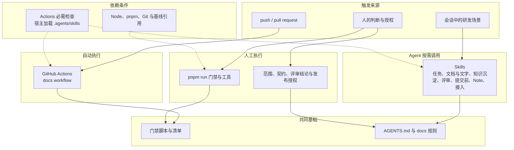

# agent-dev-template

面向 AI Agent 辅助软件研发的项目模板。它把研发输入、研发任务、设计决策、系统认知和工程知识放进各自唯一的归属位置，并让文档维护成为研发流程的一部分，而不是研发结束后的整理工作。

本仓库既是模板源仓库，也是这套体系的第一次实践：`docs/` 记录体系自身，研发活动本身用来验证和修正这套体系。

## 解决什么问题

- **认知分层**：架构、子系统、模块文档分别回答“由什么组成”“能力契约是什么”“这个单元怎么用”，读者按需深入。
- **决策留存**：Agent Notes 记录问题、方案、取舍和后果，被否决的方案一并保留，避免反复争论。
- **文档跟随研发**：触发表、专项 Skills 和变更影响检查共同推动一次改动同步它所属的文档。
- **知识参与研发**：缺陷模式、开发准则、操作指南和 Skills 在对应场景被加载，而不是堆在知识库里。
- **机械约束优先**：能由脚本判定的结构、格式、链接、预算和冻结规则不依赖 Agent 自觉。

## 组成

| 部分 | 目录 | 负责 |
|---|---|---|
| 研发输入 | [研发输入/](研发输入/README.md) | 原始需求、外部约束、参考资料、梳理草稿 |
| 研发任务 | [研发任务/](研发任务/README.md) | 当前任务目标、范围、进展、交付与归档 |
| 研发演进 | [.agents/notes/](.agents/notes/README.md) | 问题、方案、决策、取舍、否决与归档 |
| 系统认知 | [架构](docs/architecture.md)、[子系统](docs/subsystems/README.md)、模块 README、[持久化记录](docs/persistence-changes/README.md) | 当前系统是什么样 |
| 工程知识 | [核心准则](docs/core-guidelines/README.md)、[防御性模式](docs/defensive-patterns/README.md)、[cookbook](docs/cookbook/README.md)、[复盘](docs/postmortem/README.md)、`.agents/skills/` | 怎样正确地设计和操作 |
| 治理 | 根 [AGENTS.md](AGENTS.md)、[文档标准](docs/AGENTS.md)、[scripts](scripts/README.md)、`.github/workflows/` | 何时做、做没做、格式是否正确 |

对参考体系（DSH）的研究结论见 [对 DSH 开发体系研究](docs/对dsh开发体系研究/README.md)；它记录可复用的设计原则和不采纳的理由，不是本仓库的规则。

## 研发活动与触发机制

这一节按研发活动和触发场景组织，不按文件或命令罗列。体系没有统一的研发流水线：每个机制都可以独立触发，也可以按需组合；一次改动不要求依次执行全部检查。[体系架构](docs/architecture.md) 中的“一次研发的信息流”描述信息在四层之间的归属与回流，不是要求依次执行的步骤。

机制按触发与依赖关系分为四类：GitHub Actions 上的 CI 由 push 或 pull request 自动触发；Skills 由 Agent 在对应场景按需加载并调用门禁命令；命令、评审和授权也可以由人直接发起；还有一部分能力依赖项目或宿主配置。除 CI 外，本仓库没有其他自动调度入口，规则是否执行由 Agent 或人决定。

### 执行方式与依赖

| 方式 | 触发者 | 承担机制或条件 | 不保证什么 |
|---|---|---|---|
| 自动执行 | 向 GitHub 推送或发起 pull request | `docs` 工作流运行检查命令，pull request 额外以 `--strict` 运行变更影响检查 | 不检查未推送的本地改动；不阻止合并，除非仓库在平台侧把它设为必需检查 |
| Agent 按需调用 | 会话出现对应研发场景，Agent 选择加载 Skill | `.agents/skills/` 中的工作流及其调用的门禁命令：任务、文档与文字、知识沉淀、评审、提交前检查、Note 归档、项目接入 | 不强制加载，也不校验 Agent 是否执行；没有自动触发 Skill 的钩子 |
| 人工执行 | 人主动运行命令、评审或授权 | `pnpm run` 门禁与工具、变更范围命令、范围与发布授权 | 没有“全量执行”的统一要求；结果取决于人是否按规则执行和报告 |
| 依赖项目 / 宿主配置 | 环境与平台条件满足时 | GitHub Actions、Node ≥ 22.18、pnpm 11.24.0、Git、基线引用、文档 `kind` 元数据 | 条件缺失时脚本跳过或无法运行；能力随宿主和项目配置变化 |

图中的连线表示触发、使用或依赖，不表示执行顺序；各分支可以单独使用。

### 触发场景

| 研发活动 | 触发条件 | 承担机制 | 执行方式 | 执行结果 | 详细入口 |
|---|---|---|---|---|---|
| 任务生命周期 | 需要把输入或对话整理成任务，或任务交付、放弃、被替代 | task-management Skill、研发任务规则、`verify-tasks` | Agent 按需；门禁可本地或 CI 执行 | 一份任务文件位于 `研发任务/进行中/` 或 `研发任务/归档/` 下的对应目录，状态、章节与引用通过结构检查 | [任务规则](研发任务/README.md)、[task-management](.agents/skills/task-management/SKILL.md) |
| 文档编写与体系同步 | 新增或修改 README、模块文档或 `docs/` 页面 | [文档标准](docs/AGENTS.md)、doc-writing、prose-standard、`test:docs` | Agent 按需；门禁可本地或 CI 执行 | 文档按层级放置，入站链接同步，结构门禁通过 | [文档标准](docs/AGENTS.md)、[doc-writing](.agents/skills/doc-writing/SKILL.md)、[prose-standard](.agents/skills/prose-standard/SKILL.md) |
| 设计决策留存 | 出现长期取舍、被否决方案或跨模块影响 | [Agent Note 规则](.agents/notes/README.md)、archive-agent-notes、`test:notes` | Agent 按需；门禁可本地或 CI 执行 | 生命周期目录中的 Note 或冻结归档；状态与格式通过检查，归档记录另校验冻结 hash | [Agent Note 规则](.agents/notes/README.md)、[archive-agent-notes](.agents/skills/archive-agent-notes/SKILL.md) |
| 缺陷复盘与防御模式 | 修复隐蔽、系统性或重复发现成本高的缺陷 | 根 AGENTS 触发表、复盘、防御性模式 | Agent 按需 | 复盘记录与对应的防御性模式；没有专用门禁，仅受通用文档结构检查 | [复盘](docs/postmortem/README.md)、[防御性模式](docs/defensive-patterns/README.md) |
| 操作步骤与准则沉淀 | 操作步骤已验证且会重复执行；同一正确或错误写法在评审中反复出现 | 根 AGENTS 触发表、cookbook、核心准则、防御性模式 | Agent 按需 | cookbook 步骤或核心准则；没有专用门禁，仅受通用文档结构检查 | [cookbook](docs/cookbook/README.md)、[核心准则](docs/core-guidelines/README.md)、[防御性模式](docs/defensive-patterns/README.md) |
| 持久化结构记录 | 新增或变更持久化数据结构 | [持久化记录规则](docs/persistence-changes/README.md)、`verify-persistence-records` | Agent 按需；门禁可本地或 CI 执行 | 记录位置、frontmatter、必需章节、声明块、digest、前驱记录与伴生 schema 通过检查 | [持久化记录规则](docs/persistence-changes/README.md) |
| 治理机制变更 | 修改 `scripts/` 门禁、共享工具或清单；修改 Agent Note 规则、目录或校验脚本；新增或修改 `docs/` 层级、文档 kind 或写作规则 | 根 AGENTS 触发表、[文档标准](docs/AGENTS.md)、[文档门禁](docs/subsystems/documentation-gates.md)、[Agent Note 规则](.agents/notes/README.md)、`test:docs`、`test:gates`、`test:notes` | Agent 按需；门禁可本地或 CI 执行 | 按触发项同步对应归属：文档标准与字数预算、文档门禁页、scripts 说明、Note 规则页、体系架构；门禁逻辑变化同时补失败路径用例 | [文档标准](docs/AGENTS.md)、[文档门禁](docs/subsystems/documentation-gates.md)、[scripts](scripts/README.md)、[Agent Note 规则](.agents/notes/README.md) |
| 范围确认与提交前检查 | 准备提交或推送，或需要确认本次改动范围 | pre-push-checks Skill、`change-scope`、按触及面选择的门禁 | Agent 按需或人工 | 相对基线的 committed、staged、unstaged、untracked 清单；最小检查证据，失败停止 | [pre-push-checks](.agents/skills/pre-push-checks/SKILL.md)、[scripts](scripts/README.md) |
| 代码评审 | 有本地变更或 pull request 待评审 | code-review Skill、`change-scope` | Agent 按需；评审结论由人决定是否采纳 | 用证据报告 blocker 与 suggestion，不以清单全勾作为通过条件；评审 Skill 本身不产生门禁状态 | [code-review](.agents/skills/code-review/SKILL.md) |
| 机械门禁与变更影响 | push 或 pull request；或需要验证当前改动、定位门禁失败 | `docs` 工作流、`test:docs`、`test:notes`、`verify-tasks`、`test:gates`、`test:tools`、`verify-change-docs` | 自动（CI）与本地按需（Agent 或人） | 退出码和可定位诊断；pull request 额外输出变更影响清单，当前规则均为提示级 | [文档门禁](docs/subsystems/documentation-gates.md)、[scripts](scripts/README.md)、[docs workflow](.github/workflows/docs.yml) |
| 项目初始化与接入 | 空项目初始化或已有项目接入 | project-onboarding Skill、`docs/handover/` 临时区 | Agent 按需；架构、模块和子系统边界由人确认 | 以代码和实际行为建立最小系统认知，隔离旧资料，交接完成后清空临时区 | [project-onboarding](.agents/skills/project-onboarding/SKILL.md) |
| 交付与发布 | 任务完成交付；或需要对外发布、部署 | 根 AGENTS 的交付规则、pre-push-checks 的报告要求、人工授权 | 人工授权；交付由执行者报告 | 交付说明列出实际变更、验证、风险与未覆盖项；交付不等于发布，发布另行授权 | [AGENTS.md](AGENTS.md) |

机制可以组合，但不要求全量执行。例如：只改一处模块文档时按 `test:docs` 做结构验证即可；任务归档按任务规则移动文件并运行 `verify-tasks`，不必因此运行全部检查；代码评审本身不会生成自动门禁状态。

## 尚未实现与需要自行配置

- **平台与本地自动化**：CI 依赖 GitHub Actions；仓库内没有把 `docs` 工作流设为必需检查的配置，是否阻止合并在平台侧决定。本仓库不提供 Git hooks，提交前检查由 Agent 或人按 Skill 执行，不会自动运行。
- **技术栈流程**：不包含业务代码的静态检查、构建、测试、发布或部署，也不提供多平台 CI 矩阵；接入项目按自身技术栈添加。
- **规则强度**：`verify-change-docs` 当前只有 3 条 `remind` 规则，没有 `require`；pull request 的 `--strict` 只执行 `require`，当前不会因文档未同步而失败。
- **检查范围**：不校验 Mermaid、TypeScript 示例、类型与源码等价；语义归属、内容质量以及文档是否真的随行为同步，仍由评审和 Skill 判断。
- **文档发现**：模块门禁按 `kind` 元数据发现文档；未声明元数据的 README 不进入模块门禁，也没有模块清单，计数下降由评审发现。
- **知识沉淀**：复盘、cookbook、核心准则和防御性模式没有专用门禁，是否创建由根 AGENTS 触发表和评审决定。
- **流程能力**：不提供 Issue、看板、优先级、负责人、标签或自动任务流转；任务只是本地 Markdown 文件。
- **交付形态**：本仓库只维护模板的源体系，不建立文档网站，不做双语文档配对；`template/` 目前只有目录骨架，通用交付内容尚未整理。
- **宿主加载**：仓库不强制 Agent 加载 `.agents/skills/`；是否加载、是否遵守由宿主和 Agent 决定。

## 入口

任务边界与授权见根 [AGENTS.md](AGENTS.md)；体系组成、职责边界与信息流见 [体系架构](docs/architecture.md)；文档层级与写作规则见 [文档标准](docs/AGENTS.md)；决策记录规则见 [Agent Note 规则](.agents/notes/README.md)；任务记录规则见 [研发任务规则](研发任务/README.md)；门禁清单与失败语义见 [文档门禁](docs/subsystems/documentation-gates.md)；工具使用与内部设计见 [scripts](scripts/README.md)；专项工作流见各 [Skill](.agents/skills/)。

安装依赖、门禁与检查的常用命令由根 [AGENTS.md](AGENTS.md) 的命令表维护，全部脚本入口见 [package.json](package.json)；本文件不复述命令，避免产生第二份副本。
