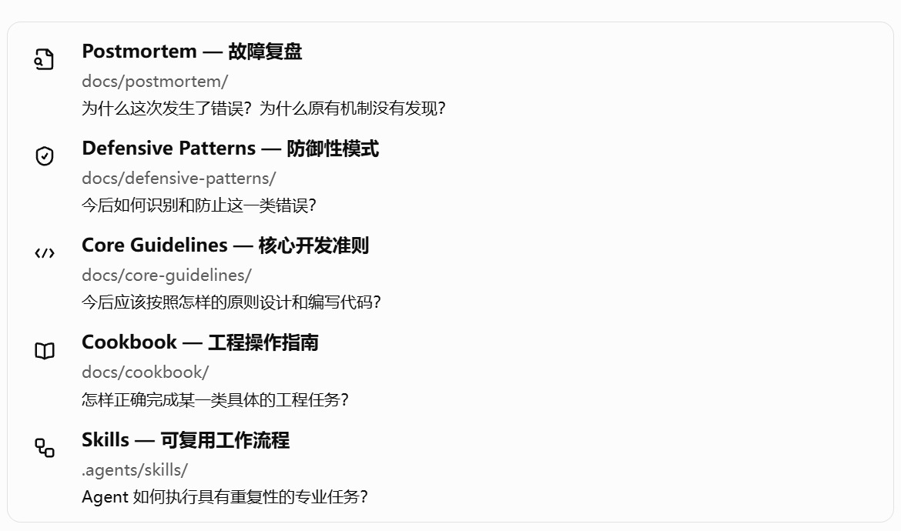

### 故障复盘

不会为每一个 Bug 编写故障复盘。它要求值得复盘的故障具备三个特点：

* **隐蔽性**：故障机制不明显，即使是谨慎的工程师也很难立即发现。
* **系统性**：故障暴露了测试、工具或工程约定的缺陷，而不只是一次拼写错误。
* **重复发现成本高**：这次已经花费大量时间排查，未来可能再次付出同样的代价。

一份复盘需要解释故障现象、根本原因、为什么原有防护机制没有发现，以及为防止复发而增加的保障措施。

### 防御性模式

这里最值得注意的是：**修复 Bug 和修复产生 Bug 的工程机制，是两件不同的事情。**

故障复盘解释过去发生了什么，但 Agent 在未来开发时，没有必要重新阅读所有历史故障。
Agent 修改相关对象之前，需要阅读对应的防御性规则，而不是每次加载全部工程经验

**信息结构**

DSH 要求每条防御性规则表达几个关键方面。

| 内容             | 作用                   |
| ---------------- | ---------------------- |
| Requirement      | 必须满足什么要求       |
| Defect           | 防止什么类型的缺陷     |
| Judged condition | 如何判断代码违反了规则 |
| Boundary         | 适用范围与例外         |
| Correct example  | 正确实现方式           |
| Wrong example    | 典型错误方式           |

这与普通的知识笔记存在很大区别。

### 核心开发准则

**将工程认识转化为开发准则**

[查看 DSH Core Guidelines](https://github.com/deepseek-ai/deepseek-harness/blob/master/docs/core-guidelines/README.md?utm_source=chatgpt.com)

DSH 借鉴 C++ Core Guidelines 的设计，建立了自己的代码编写准则，并为规则分配稳定编号。

它明确规定：即使代码实现的是另一项功能，这条规则仍然适用，才适合进入 Core Guidelines。

因此，具体业务规则不属于这里，而应该保留在对应的系统文档中。

GitHub

**Defensive Patterns 与 Core Guidelines 的区别**

|          | Defensive Patterns     | Core Guidelines      |
| -------- | ---------------------- | -------------------- |
| 主要目的 | 防止已认识到的缺陷类型 | 指导代码设计         |
| 使用重点 | 修改前查阅、代码审查   | 设计、编写、自我审查 |
| 规则范围 | 特定工程对象或缺陷     | 普遍适用的开发原则   |
| 关注问题 | 怎样避免写错           | 怎样才能写好         |

两者存在交集，但侧重点不同。

例如，DSH 的真实规则 [G.2](https://github.com/deepseek-ai/deepseek-harness/blob/master/docs/core-guidelines/general.md?utm_source=chatgpt.com#g2) 要求避免在公共接口参数中使用回调，因为调用时机、异常处理、生命周期和跨进程序列化等问题容易变得不明确。

该规则同时提供了 Promise、AsyncIterable、类型化事件等替代方式，并对事件监听器、同步比较器等场景规定了例外。

GitHub

值得学习的不是照搬这条 TypeScript 规则，而是规则必须具有**明确要求、理由、适用边界及审查标准**。

### 工程操作指南

前面两类知识主要告诉 Agent 应该遵循什么原则，但一些工程任务并不需要每次重新设计，只需要正确执行。

这份指南以真实的软件包作为参考模板，需要随实际工程约定更新。

GitHub+1

它的价值在于：把以前已经研究清楚的操作方法保存下来，避免每一个新 Agent 都重新调查如何完成相同的任务。

这类文档对于我们的个人项目也很有用。例如环境搭建、插件开发、消息总线联调、打包发布，都可以使用这种组织方式。

### Skills

**让积累下来的知识真正参与研发**

明确的分工：

| 对象            | 职责                             |
| --------------- | -------------------------------- |
| Docs            | 提供认识、依据和约束             |
| Skills          | 规定在什么场景下怎样使用这些知识 |
| AGENTS.md       | 将知识和工作流程接入日常开发     |
| Tests / Scripts | 对能够客观验证的要求进行检查     |

这说明知识库与 Skills 不应该相互替代，而应该相互配合。
