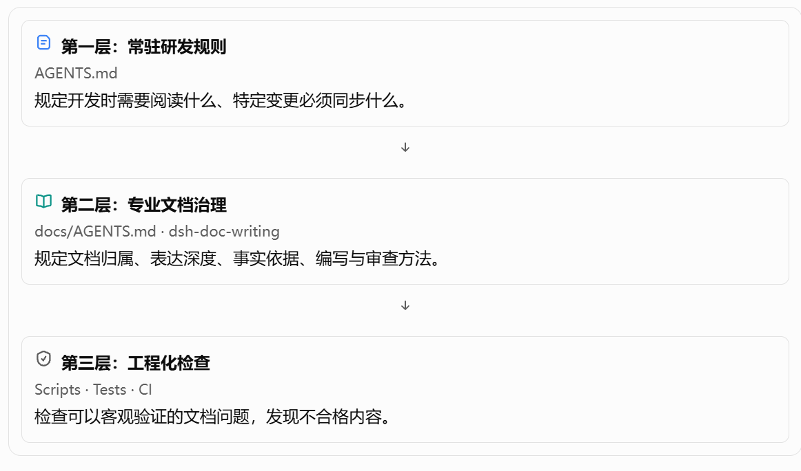
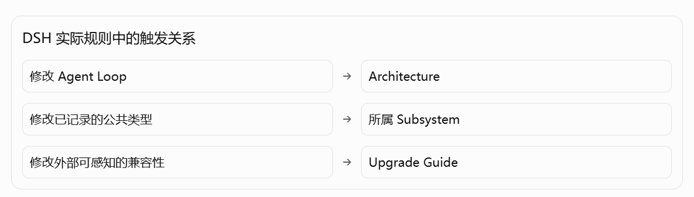
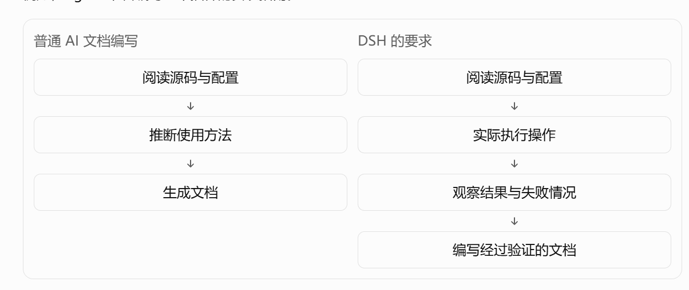

**DSH 如何让 Agent 持续维护这些文档，避免遗漏、过时、重复和低价值内容不断积累？**

* [根 AGENTS.md](https://github.com/deepseek-ai/deepseek-harness/blob/master/AGENTS.md?utm_source=chatgpt.com)
* [docs/AGENTS.md — 文档治理规范](https://github.com/deepseek-ai/deepseek-harness/blob/master/docs/AGENTS.md?utm_source=chatgpt.com)
* [dsh-doc-writing — 文档编写 Skill](https://github.com/deepseek-ai/deepseek-harness/blob/master/.agents/skills/dsh-doc-writing/SKILL.md?utm_source=chatgpt.com)

| 层次     | 解决的问题                    |
| -------- | ----------------------------- |
| 常驻规则 | Agent 什么时候应该处理文档？  |
| 专业治理 | Agent 应该如何正确处理文档？  |
| 工程检查 | 如何发现 Agent 没有正确执行？ |

我们之前的 agent-docs 主要集中在第二层，通过 skills-reminder 补充第一层，却缺少第三层的客观检查机制。

# **二、DSH 如何触发文档维护？**

这是非常值得研究的部分。

DSH 在根 `AGENTS.md` 中规定，修改 `packages/` 之前必须阅读系统架构文档；修改 `agent-loop` 时，必须同步更新 `docs/architecture.md`。

另外，已经被文档描述的类型发生变化时，所属子系统文档必须在同一次变更中更新；外部用户能够感知的破坏性变更，需要立即记录到升级指南。

这种规则有一个明显的优势：**减少 Agent 需要自行进行的价值判断。**

当然，DSH 也没有为每一种代码修改建立强制对应关系。上述规则主要针对重要的系统机制和契约，其他内容仍然需要正常的工程判断。

这不是一套通用的要想好用也无法通用 ，详细准确才是能够正常运转的基础

**三、DSH 如何保证文档内容真实？**

DSH 的文档编写 Skill 中，有一项相当严格的要求：

**对于操作性描述，必须实际执行，而不能仅凭阅读代码、已有文档或者模型的经验进行推测。**

| Skill              | 职责                                         |
| ------------------ | -------------------------------------------- |
| dsh-doc-writing    | 文档放在哪里、采用什么结构、如何验证         |
| dsh-prose-standard | 什么内容值得写、如何准确表达、哪些内容应删除 |

后者甚至不仅治理 Markdown，还治理 JSDoc、代码注释、测试注释、提示词和错误信息。

**1. 保留真正有价值的行为契约**

**2. 删除推理过程，而不是删除推理成果**

| 应当保留             | 通常应当删除           |
| -------------------- | ---------------------- |
| 系统实际行为         | 逐步阅读代码的过程     |
| 非显而易见的设计依据 | 对明显代码逻辑的解释   |
| 重要失败条件         | 测试执行流水           |
| 不可违反的约束       | 重复论证               |
| 有意义的候选方案取舍 | 局部实现中无价值的尝试 |
| 当前限制             | 已失效的实施步骤       |

DSH 在 [package.json](https://github.com/deepseek-ai/deepseek-harness/blob/master/package.json?utm_source=chatgpt.com) 中注册了大量文档检查命令。

| 检查命令                            | 检查内容                   |
| ----------------------------------- | -------------------------- |
| `verify-doc-budgets`              | 核心文档篇幅               |
| `verify-md-links`                 | Markdown 链接有效性        |
| `verify-mermaid`                  | Mermaid 图                 |
| `doc-typecheck`                   | 文档中的 TypeScript 代码   |
| `verify-type-equiv`               | 文档中的类型与源码的一致性 |
| `verify-agent-note-format`        | 设计文档格式与生命周期要求 |
| `verify-archived-agent-notes`     | 历史归档是否被修改         |
| `verify-package-readme-summaries` | 模块 README 摘要规范       |
| `verify-translation-pairing`      | 双语文档配对关系           |
| `verify-module-graph`             | 自动生成的模块关系图       |
