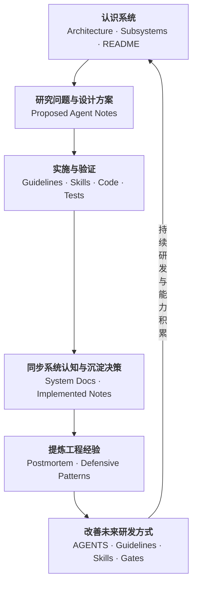

01

**文档体系与职责划分**

为什么需要这些文档？它们分别承担什么职责？

建立整体认识

本次

02

**系统认知的组织**

架构、子系统、模块文档如何分工？应该写到什么程度？

解决 Project 问题

03

**研发过程与设计演进**

需求、提案、实施、决策、否决和归档如何管理？

解决 Design 问题

04

**文档治理与持续维护**

何时创建、何时修改、如何验证、何时删除？

解决自动维护问题

05

**工程经验与知识沉淀**

如何将缺陷、经验和认识转化为持续的研发能力？

提高长期研发质量
