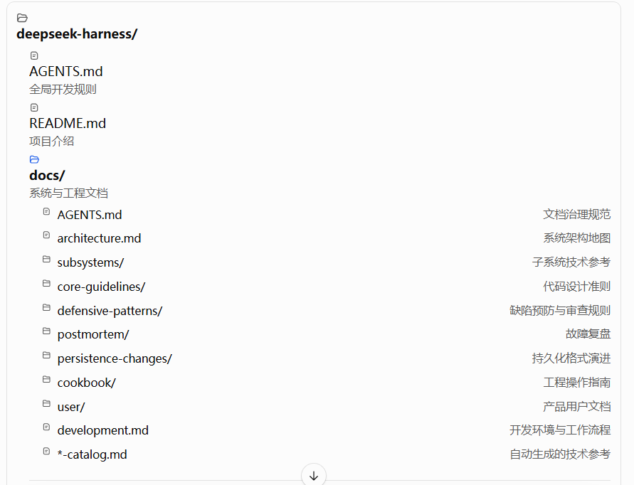
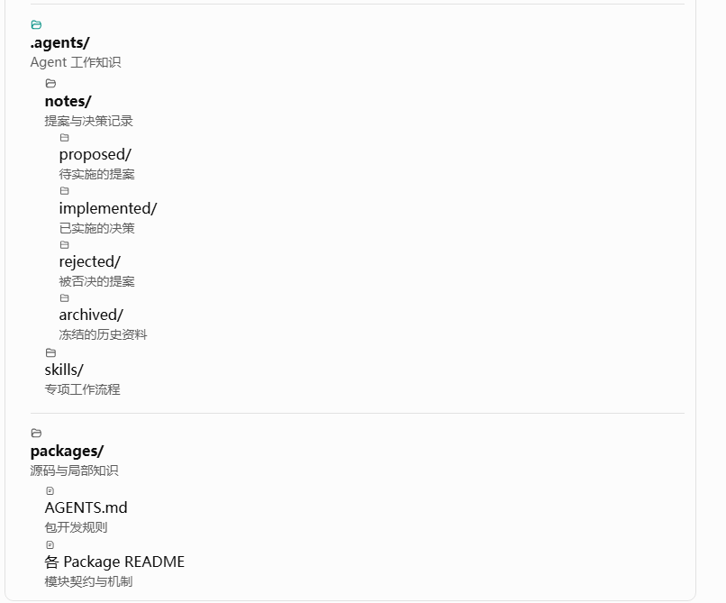
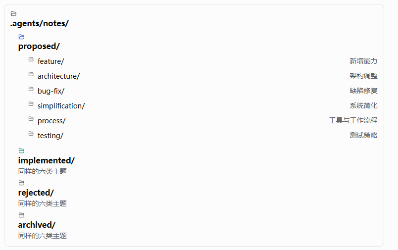
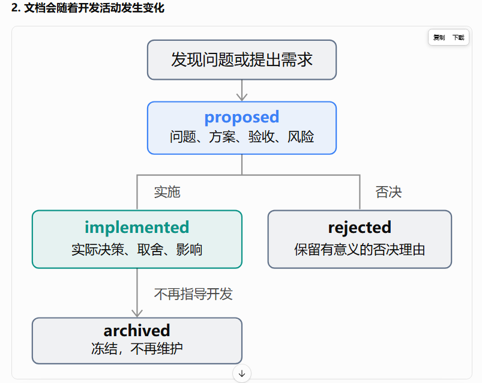
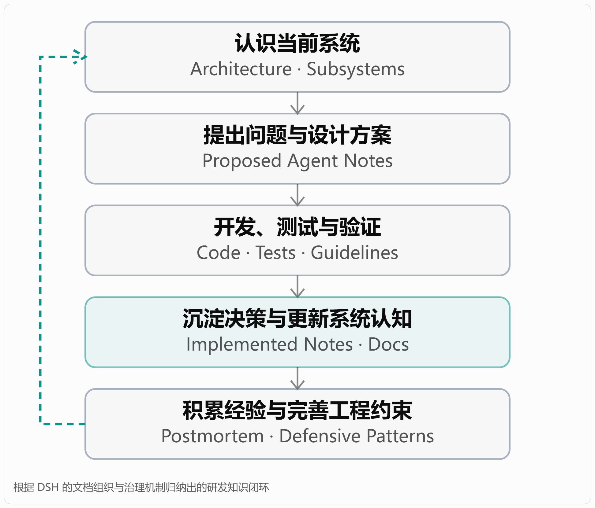
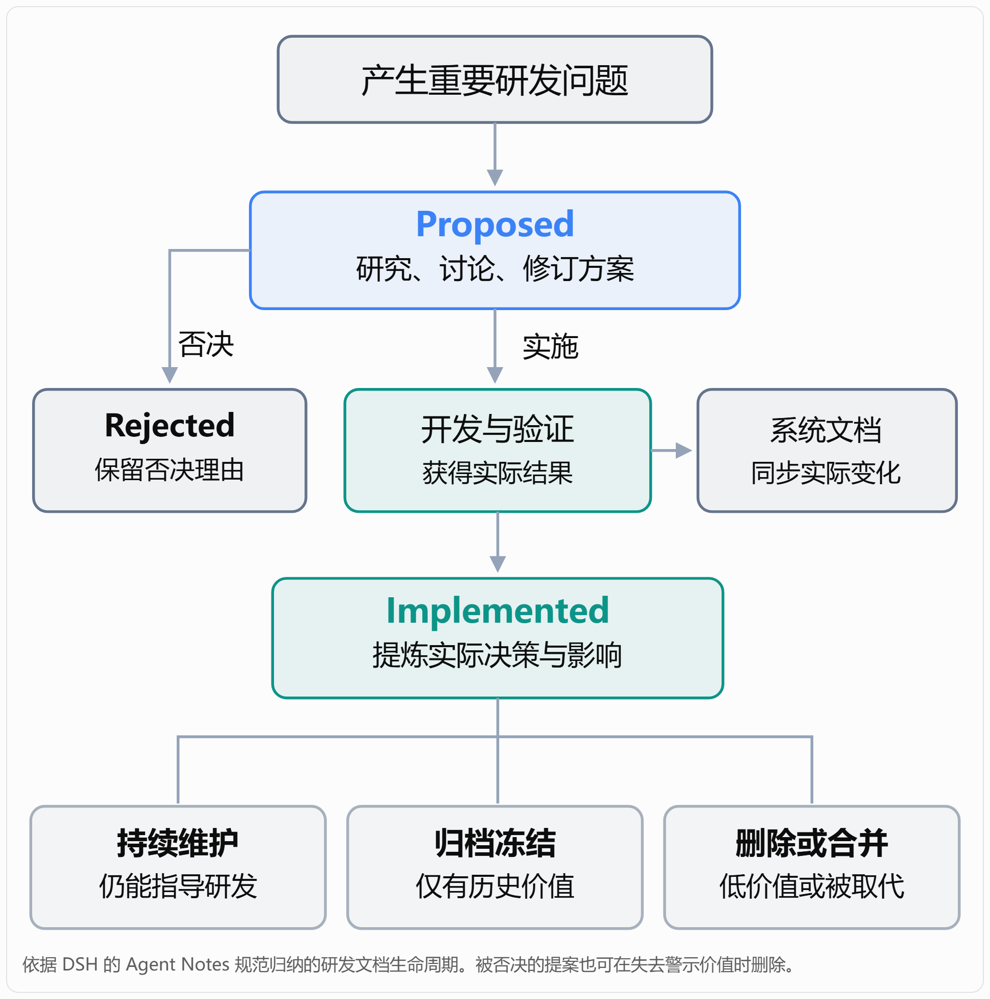

**表达当前系统**

DSH 并没有建立一个统一的 Project 目录，而是将当前系统的认知分为三个层次。

系统层**architecture.md**

全局组成、核心模块、运行循环、扩展机制、组件关系。

子系统层**subsystems/**

子系统的数据结构、类型、语义、服务及事件接口。

具体模块层**Package README**

模块配置、行为契约、限制、扩展点以及对模型的影响。

**Source Code — 具体实现**

| 文档       | 阅读入口                                                                                                                                       |
| ---------- | ---------------------------------------------------------------------------------------------------------------------------------------------- |
| 系统架构   | [architecture.zh.md](https://github.com/deepseek-ai/deepseek-harness/blob/master/docs/architecture.zh.md?utm_source=chatgpt.com)                  |
| 子系统索引 | [subsystems/README.md](https://github.com/deepseek-ai/deepseek-harness/blob/master/docs/subsystems/README.md?utm_source=chatgpt.com)              |
| 核心子系统 | [subsystems/core.md](https://github.com/deepseek-ai/deepseek-harness/blob/master/docs/subsystems/core.md?utm_source=chatgpt.com)                  |
| Agent 模块 | [packages/core/agent/README.md](https://github.com/deepseek-ai/deepseek-harness/blob/master/packages/core/agent/README.md?utm_source=chatgpt.com) |

DSH 明确限制每个层级的描述范围，上层只描述下层的职责与主要行为，具体细节链接到其所属文档。

**需求、设计及开发活动：Agent Notes**

Agent Note 本质上是由 Agent 编写的 RFC，用于保存代码、测试和普通文档难以表达的重要设计理由、候选方案、取舍及验证要求

**1. 按生命周期与变更性质组织**

DSH 明确禁止为这些 Notes 建立集中式 `INDEX.md`，因为目录和文件名已经表达了状态与分类，重复维护索引只会产生额外成本。

尚未实施的提案与已经实施的决策，使用不同的文档结构。

**实施前**

Problem — 问题

Proposal — 提议方案

Alternatives — 候选方案

Acceptance criteria — 验收条件

Risks — 风险

**实施后**

Problem — 问题

Decision — 实际决策

Alternatives — 候选方案

Consequences — 代价与收益

Testing — 验证（可选）

完成实施后，Agent 需要改写文档，将未来计划转换为已实现的事实，移除已经失去意义的实施步骤和验收清单。

# **六、DSH 的几个重要文档原则**

我从它的 [文档治理规范](https://github.com/deepseek-ai/deepseek-harness/blob/master/docs/AGENTS.md?utm_source=chatgpt.com) 和 [文档编写 Skill](https://github.com/deepseek-ai/deepseek-harness/blob/master/.agents/skills/dsh-doc-writing/SKILL.md?utm_source=chatgpt.com) 中提炼出以下特点。

| 原则              | 含义                                   |
| ----------------- | -------------------------------------- |
| One home per fact | 每个事实只有一个主要维护位置           |
| 当前状态优先      | 普通文档描述现状，历史单独保存         |
| 就近组织          | 模块知识放在模块代码附近               |
| 层级约束          | 上层不重复下层的实现细节               |
| 生命周期管理      | 提案、实施、否决、归档采用不同维护策略 |
| 工程化校验        | 能通过程序检查的内容不完全依赖 AI      |
| 控制信息膨胀      | 删除重复、过时及低价值的内容           |

# **七、它有没有需求与 AI 工作记录的位置？**

| 内容             | DSH 的处理方式                           |
| ---------------- | ---------------------------------------- |
| 重要功能需求     | proposed/feature/                        |
| 架构设计需求     | proposed/architecture/                   |
| 实施方案与验收   | proposed Agent Note 内部                 |
| 已完成的重要工作 | implemented/                             |
| 被否决的设计     | rejected/                                |
| 历史开发成果     | archived/、Git、PR                       |
| 故障调查记录     | postmortem/                              |
| 临时工作材料     | 按需使用 scratch                         |
| 普通 AI 工作记录 | 未发现统一的长期工作日志体系             |
| 长期产品愿景     | 未发现类似 OpenClaw VISION.md 的独立入口 |

DSH 并不记录所有 AI 干过的活，而是记录具有持续工程价值的开发活动及决策。

## **DSH 的文档体系实际上承担了五项职责**

| 职责     | 对应文档                                 | 目的                       |
| -------- | ---------------------------------------- | -------------------------- |
| 系统认知 | architecture、subsystems、Package README | 理解当前系统               |
| 研发演进 | Agent Notes                              | 管理需求、提案、方案、决策 |
| 工程约束 | AGENTS、core-guidelines                  | 指导正确开发               |
| 经验积累 | postmortem、defensive-patterns           | 从错误中积累认识，防止复发 |
| 文档治理 | docs/AGENTS、检查脚本、编写 Skills       | 保持文档质量与有效性       |

其中产品使用文档只是 `docs/user/` 承担的一个部分。

01

**文档体系与职责划分**

为什么需要这些文档？它们分别承担什么职责？

建立整体认识

本次

02

**系统认知的组织**

架构、子系统、模块文档如何分工？应该写到什么程度？

解决 Project 问题

03

**研发过程与设计演进**

需求、提案、实施、决策、否决和归档如何管理？

解决 Design 问题

04

**文档治理与持续维护**

何时创建、何时修改、如何验证、何时删除？

解决自动维护问题

05

**工程经验与知识沉淀**

如何将缺陷、经验和认识转化为持续的研发能力？

提高长期研发质量

**DSH 如何触发文档维护** 不是按照通用规则而是  根据实际项目具体的给了指令的
