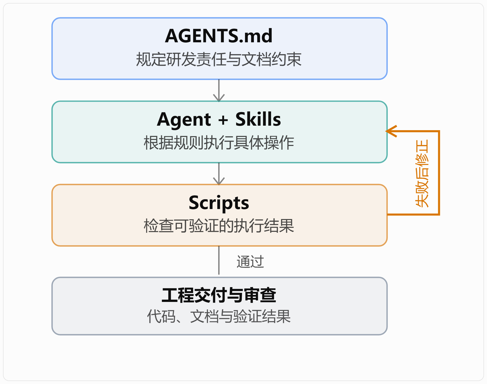
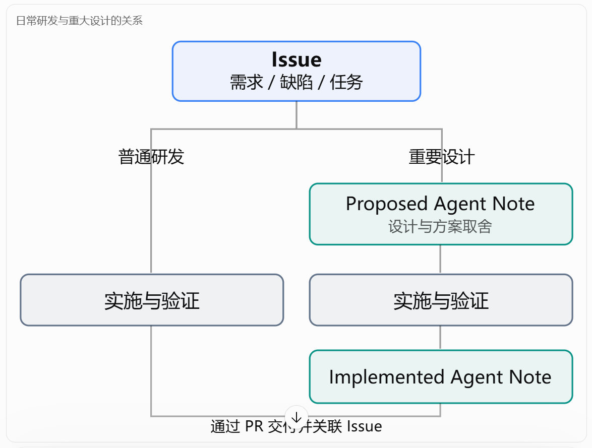

提议中
尚未完整实施的提案
新增能力
架构变更
缺陷修复
系统简化
研发流程
测试策略
已实施
尚未完整实施的提案
新增能力
架构变更
缺陷修复
系统简化
研发流程
测试策略
已拒绝
尚未完整实施的提案
新增能力
架构变更
缺陷修复
系统简化
研发流程
测试策略
已归档
尚未完整实施的提案
新增能力
架构变更
缺陷修复
系统简化
研发流程
测试策略

文件名采用 `yyyy-mm-dd-topic-title.md`

**目录本身就是研发事项清单，不再额外维护集中式索引。**

DSH 如何将文档生命周期从一种设计理念，落实为可以执行的研发机制？
DSH 的 Agent Notes 中文规范，其中明确规定 Agent Note 随状态变化在文件夹之间移动。
DSH 通过脚本检查文件所在目录、状态行及正文章节是否匹配。

状态是研发事实，结构是状态的表达。


通过脚本[verify-agent-note-format.ts](https://github.com/deepseek-ai/deepseek-harness/blob/master/scripts/verify-agent-note-format.ts?utm_source=chatgpt.com)去保障



| 组成 | DSH 的实际文件                                                                                                                                             | 负责内容                                       |
| ---- | ---------------------------------------------------------------------------------------------------------------------------------------------------------- | ---------------------------------------------- |
| 规范 | [Agent Notes README](https://github.com/deepseek-ai/deepseek-harness/blob/master/.agents/notes/README.zh.md?utm_source=chatgpt.com)                           | 什么可以归档，什么必须保留                     |
| 操作 | [dsh-archive-agent-notes](https://github.com/deepseek-ai/deepseek-harness/blob/master/.agents/skills/dsh-archive-agent-notes/SKILL.md?utm_source=chatgpt.com) | 如何调查价值、判断取代关系、迁移文件、修复链接 |
| 检查 | [verify-archived-agent-notes.ts](https://github.com/deepseek-ai/deepseek-harness/blob/master/scripts/verify-archived-agent-notes.ts?utm_source=chatgpt.com)   | 检查归档结构、元数据及冻结内容是否被修改       |


| 核心思想               | 实际作用               |
| ---------------------- | ---------------------- |
| 以研发问题为记录单位   | 不按对话回合记录       |
| 保存真实的设计取舍     | 避免未来反复争论       |
| 文档随研发阶段演进     | 从提案转化为实际决策   |
| 区分事实变化与决策变化 | 保持有效性与历史真实性 |
| 建立退出机制           | 避免文档规模无限膨胀   |

其中最重要的改变是：

**研发文档不是研发工作的副产品，而是研发活动的载体；不是每次对话后都判断要不要记录，而是在有意义的研发活动中建立、使用和演进文档。**


**是的，**`Proposed → Implemented → Archived` **这套生命周期主要针对** `.agents/notes/` **下的 Agent Notes，并不是 DSH 全部研发文档的统一生命周期。**

不过，我认为 Agent Notes 不能完全被视为系统的外部输入。它更接近于**研发输入经过分析后形成的工程提案，以及实施后沉淀的设计决策**。

## **一、区分三种不同性质的研发信息**

| 信息     | 核心问题                           | DSH 对应载体                             |
| -------- | ---------------------------------- | ---------------------------------------- |
| 研发输入 | 为什么要做？需要解决什么问题？     | Discussions、Issues                      |
| 研发设计 | 准备怎样解决？为什么选择这个方案？ | Agent Notes                              |
| 系统认知 | 实际实现了什么？现在怎样运行？     | Architecture、Subsystems、Package README |

例如，用户提出希望 DSH 支持定时执行任务，这是研发输入。

研发人员研究调度机制、持久化方式、任务生命周期，并提出具体方案，这是研发设计。

功能实现之后，描述调度模块的实际行为、接口及限制，这是系统认知。

**研发输入**

用户需求 · 产品想法 · 缺陷 · 外部约束

**Proposed Agent Note**

问题分析 · 设计方案 · 验收条件

**研发实施与验证**

**Implemented**

为什么形成当前设计

**System Docs**

当前系统是什么样

根据 DSH 的文档职责归纳，并非所有需求都必须经过 Agent Note。

## **二、DSH 有没有更偏向日常开发的需求文档？**

**有对应机制，但它主要使用 GitHub Issues，而不是在仓库中建立独立的 Requirements 文档目录。**

我检查了 DSH 的 `.github/ISSUE_TEMPLATE/`，它提供三种研发事项模板。

**Feature — 功能需求**

[原始模板](https://github.com/deepseek-ai/deepseek-harness/blob/master/.github/ISSUE_TEMPLATE/feature.md?utm_source=chatgpt.com)

```
## Motivation
当前问题、受影响的用户、为什么需要变化。

## Behavior
预期的用户、模型或系统可观察行为。
```

**Bug — 缺陷**

[原始模板](https://github.com/deepseek-ai/deepseek-harness/blob/master/.github/ISSUE_TEMPLATE/bug.md?utm_source=chatgpt.com)

```
## Summary
## Reproduction
## Current behavior
## Expected behavior
## Environment
```

**Task — 普通研发任务**

[原始模板](https://github.com/deepseek-ai/deepseek-harness/blob/master/.github/ISSUE_TEMPLATE/task.md?utm_source=chatgpt.com)

```
## Summary
需要完成的工作。

## Deliverables
需要交付的代码、文档、配置或结论。
```

这实际上就是一套非常轻量的需求与研发任务管理体系。

尤其是 Feature 模板，它没有要求提供技术方案，只要求说明动机和预期行为。这与 Agent Notes 的职责明显不同。

## **三、Issue 和 Agent Notes 如何配合？**

DSH 甚至为 Issues 建立了专门的[治理机制](https://github.com/deepseek-ai/deepseek-harness/blob/master/.github/issue-management/README.md?utm_source=chatgpt.com)。



其 PR 编写规范要求引用至少一个同仓库的 Issue，符合条件的 PR 会由 CI 检查引用和优先级是否符合要求。GitHub Actions 还会根据研发事件自动调整关联事项的状态。

日常研发与重大设计的关系

普通研发完全可以不创建 Agent Note。只有涉及值得长期保留的设计依据时，才需要进入 Agent Notes 体系。

## **四、对于我们的项目，需求文档仍然有必要**

DSH 是开源基础设施项目，其需求来源、研发组织方式和我们日常的软件开发存在差异。

我们的项目还可能涉及：

| 研发输入 | 示例                           |
| -------- | ------------------------------ |
| 产品愿景 | 游戏最终要形成怎样的体验       |
| 业务需求 | 仿真软件需要支持哪些业务能力   |
| 客户需求 | 客户提供的功能要求及验收标准   |
| 外部资料 | 第三方接口、通信协议、技术规范 |
| 日常任务 | 新增功能、修复缺陷、调整行为   |

这些内容并不适合全部塞入 Agent Notes。

如果我们希望项目能够独立于 GitHub Issues 使用，我倾向于保留一个轻量的研发输入空间，承担 DSH 的 Issues 所承担的部分职责，同时容纳业务需求和外部资料。

## **五、目前可以确定的认识**

| 文档体系              | 核心职责                   | 生命周期               |
| --------------------- | -------------------------- | ---------------------- |
| Requirements / Inputs | 项目要做什么、依据什么     | 随需求变化             |
| Agent Notes           | 如何解决问题、为何这样设计 | 提案、实施、否决、归档 |
| System Docs           | 当前实际系统是什么样       | 持续同步               |

**需求是研发的输入，Agent Notes 是研发思考与决策的载体，System Docs 是研发成果的认知表达。**

这三者有明确的关系，但不应该相互替代。

DSH 的 Agent Notes 值得借鉴，不过我们没有必要因为学习了这套机制，就舍弃原有的需求管理能力。
