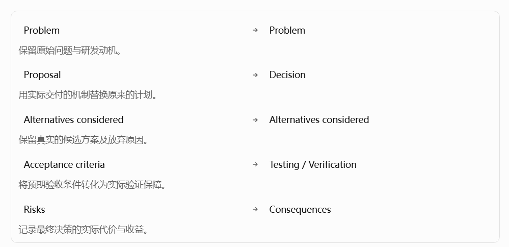

提议中
尚未完整实施的提案
新增能力
架构变更
缺陷修复
系统简化
研发流程
测试策略
已实施
尚未完整实施的提案
新增能力
架构变更
缺陷修复
系统简化
研发流程
测试策略
已拒绝
尚未完整实施的提案
新增能力
架构变更
缺陷修复
系统简化
研发流程
测试策略
已归档
尚未完整实施的提案
新增能力
架构变更
缺陷修复
系统简化
研发流程
测试策略

文件名采用 `yyyy-mm-dd-topic-title.md`

**目录本身就是研发事项清单，不再额外维护集中式索引。**

DSH 如何将文档生命周期从一种设计理念，落实为可以执行的研发机制？
DSH 的 Agent Notes 中文规范，其中明确规定 Agent Note 随状态变化在文件夹之间移动。
DSH 通过脚本检查文件所在目录、状态行及正文章节是否匹配。

状态是研发事实，结构是状态的表达。

通过脚本[verify-agent-note-format.ts](https://github.com/deepseek-ai/deepseek-harness/blob/master/scripts/verify-agent-note-format.ts?utm_source=chatgpt.com)去保障

| 组成 | DSH 的实际文件                                                                                                                                             | 负责内容                                       |
| ---- | ---------------------------------------------------------------------------------------------------------------------------------------------------------- | ---------------------------------------------- |
| 规范 | [Agent Notes README](https://github.com/deepseek-ai/deepseek-harness/blob/master/.agents/notes/README.zh.md?utm_source=chatgpt.com)                           | 什么可以归档，什么必须保留                     |
| 操作 | [dsh-archive-agent-notes](https://github.com/deepseek-ai/deepseek-harness/blob/master/.agents/skills/dsh-archive-agent-notes/SKILL.md?utm_source=chatgpt.com) | 如何调查价值、判断取代关系、迁移文件、修复链接 |
| 检查 | [verify-archived-agent-notes.ts](https://github.com/deepseek-ai/deepseek-harness/blob/master/scripts/verify-archived-agent-notes.ts?utm_source=chatgpt.com)   | 检查归档结构、元数据及冻结内容是否被修改       |
