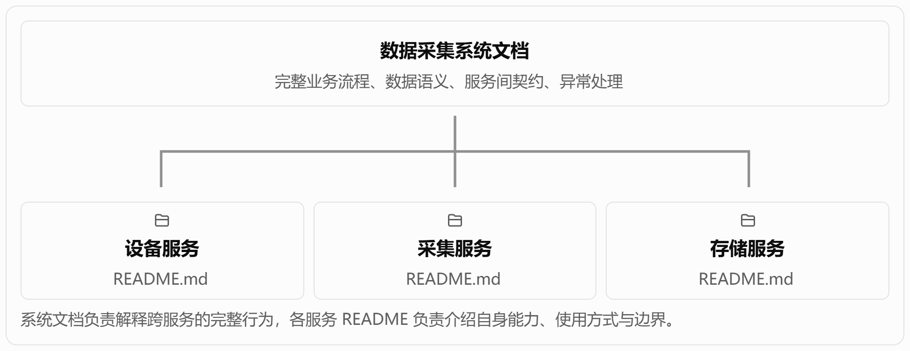
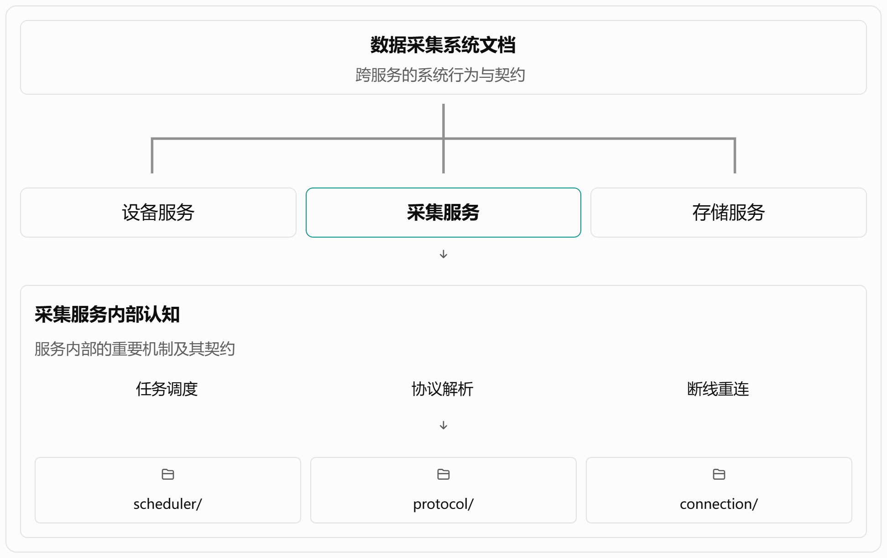

| 文档类型                      | 中文名称 | 英文名称      |
| ----------------------------- | -------- | ------------- |
| Architecture                  | 架构     | Architecture  |
| Subsystem                     | 子系统   | Subsystem     |
| Package README / Group README | 模块说明 | Module README |

**子系统描述系统的能力与契约，模块说明介绍承载这些能力的实际软件组成单元。**

## **1. Subsystem**

围绕系统中具有独立意义的业务能力或技术机制，建立准确、可深入查阅的系统知识，重点描述相关概念、数据结构、状态语义、接口契约、生命周期、行为约束及重要机制，使人和 Agent 能够准确理解系统的一部分，并据此开展研发。它不承担整个系统的架构介绍，不负责具体软件包的安装、配置和使用指导，也不记录设计历史和研发过程。

## **2. Package README**

围绕一个实际存在的软件组成单元，帮助人和 Agent 认识它提供什么能力、适用于什么场景、如何选择、使用和配置它，以及它具有哪些行为特征、限制和扩展能力。以使用者和调用者的视角为主，辅以必要的设计思想、内部机制及源码导航；不追求完整描述代码实现，不重复系统级技术契约、完整接口定义及其他组成单元的知识。

|          | Subsystem                | Package README             |
| -------- | ------------------------ | -------------------------- |
| 描述对象 | 系统能力与机制           | 实际软件组成单元           |
| 核心目的 | 准确理解系统             | 正确认识和使用软件组成单元 |
| 主要内容 | 概念、语义、契约、约束   | 能力、用途、使用、限制     |
| 阅读场景 | 研究系统、设计、修改机制 | 了解、选择、接入、使用模块 |
| 表达特点 | 精确、深入、便于查阅     | 直观、渐进、面向使用       |

Subsystem 与实际 Package Group 存在明确的归属关系。

## **DSH 甚至有脚本强制检查这种关系**

[verify-subsystem-pages.ts](https://github.com/deepseek-ai/deepseek-harness/blob/master/scripts/verify-subsystem-pages.ts?utm_source=chatgpt.com)

这个脚本要求每个 Package Group：

* 必须拥有自己的 README。
* README 必须直接链接至少一份真实存在的 Subsystem 文档。
* 如果不需要 Subsystem 文档，必须登记豁免及其理由。

系统文档必须建立在实际软件组成与业务能力之上，并与相关代码实现保持明确的关联。该关联用于系统理解、实现导航、变更影响分析和文档维护。允许根据项目实际结构建立一对一、一对多或多对多的关系，不强制文档与源码目录一一对应，也不要求为所有代码建立独立文档。

## **承担三个职责**

| 职责     | 实际作用                                       |
| -------- | ---------------------------------------------- |
| 认知导航 | 从系统文档找到对应实现，从代码找到相关系统文档 |
| 维护定位 | 修改代码时，能够明确定位需要核对的文档         |
| 覆盖检查 | 发现重要业务能力或技术机制是否缺少必要说明     |

这样，当 Agent 修改 `DeviceService` 时，就可以明确知道需要核对设备管理文档，而不必重新从整个 Docs 中判断哪些知识可能受到影响。

如果一个服务比较复杂 那么我们甚至可以为其专门再创建一层 而不是破坏目前的关系

**当某个服务自身变得复杂**

## **实际上形成了一种可递归的组织方式**

| 软件规模       | 文档组织方式                         |
| -------------- | ------------------------------------ |
| 简单控制台程序 | 整体架构与必要的机制说明             |
| 普通单体 API   | 系统文档与业务模块关联               |
| 复杂单体应用   | 系统文档与模块关联，复杂模块继续展开 |
| 微服务系统     | 跨服务系统文档与各服务关联           |
| 大型软件系统   | 各复杂服务内部可以再次建立认知结构   |

这里的递归不是要求每个服务都复制一套完整的 Docs，而是**在复杂度确实需要时，复用相同的认知组织关系。**

## **设计原则**

* 系统文档与实际工程组成保持明确关联。
* 跨工程、跨服务的行为与契约由相应的上层系统文档负责。
* 工程组成单元负责介绍自身的能力、使用方式和边界。
* 复杂工程组成单元可以进一步建立内部认知结构，而不改变原有的上层关联。
* 各层只承担自身范围内的知识，不重复维护其他层已经负责的内容。
